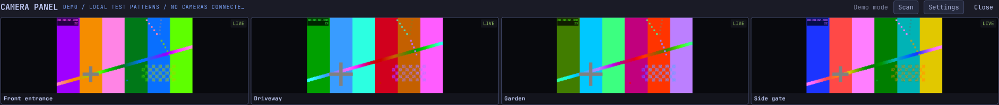

# Camera Panel

A small, native ONVIF camera monitor for **Omarchy and Hyprland**. Click the eye in
your tray to open live feeds in one compact row along the top of your screen.
Multiple NVRs share the same panel. No browser, cloud account, or recording server.



*Demo image uses generated test patterns, not security camera footage.*

**Early release:** tested with Reolink RLN8-410 recorders on Hyprland. Other ONVIF
devices and layer-shell compositors may need compatibility fixes.

## Features

- One automatically sized row, with per-camera **Add camera / Remove camera** controls.
- Multiple ONVIF NVRs, local discovery on each panel opening, and manual addresses.
- Low-resolution substreams, concurrent decoders, and progressive camera startup.
- Persistent last-live previews, clearly marked **SNAPSHOT** until video is **LIVE**.
- A ten-second stream connection deadline with an explicit **Retry** button.
- Desktop keyring passwords, private local preview files, and no telemetry.
- Omarchy palette and font integration, including live theme changes.
- Optional, consent-based UFW discovery setup. The firewall is never disabled.

## Requirements

- Linux with a Wayland compositor supporting layer-shell, such as Hyprland.
- A StatusNotifierItem-compatible tray, a session D-Bus, and a running Secret
  Service keyring with an unlocked default collection.
- Python 3.11+, PyGObject, requests, GTK 4.12+, gtk4-layer-shell, libsecret,
  FFmpeg, and fontconfig. The Arch dependency names appear below.
- UFW and a desktop polkit agent are optional, for the firewall setup prompt.

Omarchy supplies most of these components. X11 and browser-only environments are
not supported. `pip` alone does not install the native GTK/Wayland dependencies.

## Install

### Omarchy / Arch

Install the runtime dependencies:

```sh
omarchy pkg add python-gobject python-requests gtk4 gtk4-layer-shell libsecret ffmpeg
```

Download a release from [GitHub Releases](https://github.com/jacobwhite/camera-panel/releases),
extract it, and run this inside the extracted directory:

```sh
python install.py
```

This installs a standalone copy in `~/.local/share/camera-panel`, a `camera-panel`
launcher, desktop entry, icon, and `camera-panel.service`. It starts the tray and
enables startup with your graphical session. You may delete the extracted source
afterward. No root access is needed for this installation.

Use `python install.py --no-start` to install files without starting/enabling the
service. Re-run the installer to update an unmodified installed copy; it refuses
to overwrite files it does not own or that have been edited locally.

### Arch Package

An AUR-ready recipe is provided in `packaging/PKGBUILD`. **It is not yet listed in
the AUR.** From a checkout, or from the release's separate Arch recipe directory:

```sh
makepkg -si
systemctl --user enable --now camera-panel.service
```

Run `makepkg` from the directory containing `PKGBUILD`, as your normal user. The
recipe downloads the versioned source release and verifies its SHA-256 checksum.
The package does not enable a service or change firewall rules during installation.

### Tray Icon

If Omarchy puts the eye in its collapsed tray drawer, right-click the tray
chevron, choose **Tray icons**, and pin **Camera Panel**. The internal tray ID is
`lookout`, retained for compatibility with early installations and existing pins.

## Use

```sh
camera-panel                 # Toggle the camera row
camera-panel --settings      # Manage cameras and recorders
camera-panel --background    # Tray only; warm metadata, but do not stream video
camera-panel --demo          # Local moving test patterns, no real cameras
camera-panel --version
systemctl --user status camera-panel.service
```

- **Settings > Add NVR:** enter an IP, hostname, optional ONVIF port, or full device
  service URL. Verification discovers its cameras; it can be disabled for an
  offline recorder. More than one NVR is supported.
- **Settings > camera list:** remove individual cameras from the strip or add them
  back. Choices survive rescans and restarts. This does not change the NVR, its
  recordings, or its camera configuration. Removed feeds retain their last preview.
- **Discovery:** opening the panel scans the local LAN. If no cameras are available
  and an NVR is found, the panel offers **Add NVR**, never adding it silently.
  Saved recorders are matched against their advertised ONVIF addresses.
- **One row:** enabled feeds shrink to fit the output width. There is no row-count
  customization or horizontal scrolling. Names and status details are also available
  in tooltips when tiles become narrow.
- **Snapshots:** previous images are dimmed, timestamped, and marked **SNAPSHOT**.
  Only newly decoded frames are marked **LIVE**. Cached cameras can appear even
  while the recorder is unavailable.
- **Timeout:** metadata placeholders show **Loading**; video attempts show
  **Connecting**. Each stream receives a ten-second connection budget. A timed-out
  or disconnected feed retains its preview and offers **Retry**. Closing and
  reopening also reconnects. A live feed with no complete frame for ten seconds
  times out; retries do not continue indefinitely.
- **Close or Escape:** all video decoders stop. In-progress metadata/discovery
  requests may finish in the background.

## Discovery And Firewalls

Enable ONVIF on the recorder and create a live-view-enabled ONVIF user if needed.
This account and port may differ from the web-login credentials. Example addresses:
`192.168.1.100:8000` or `http://192.168.1.100/onvif/device_service`.

Discovery sends IPv4 multicast to UDP **3702** and receives replies on local UDP
**37020**. It does not scan IP ranges or TCP ports. Discovery generally cannot
cross VLANs or VPNs; add routed recorders manually.

UFW can block the unicast replies to a multicast probe. After an empty scan,
Camera Panel checks for confirmed kernel-log blocks or a potentially blocking
UFW policy. It asks before requesting a narrow allowance for the current private
subnet and interface, UDP source port 3702 to destination port 37020. Administrator
approval is required. **Not now** leaves the firewall unchanged and remembers your
decision. Revisit it in **Settings > Discovery firewall settings**.

Other firewall managers are not modified. Any approved UFW rule remains until
you remove it. Review it using `sudo ufw status numbered`; the rule comment is
`Camera Panel ONVIF discovery` (or `Lookout ONVIF discovery` on older installs).

## Playback And Compatibility

Media1/Media2, HTTP Digest, challenged Basic auth, and WS-Security password digests
are supported. Camera-clock compensation is attempted when available. Profiles
are grouped by source identity and the smallest usable advertised stream is
preferred, avoiding duplicate main/substream feeds.

Video is decoded locally with FFmpeg over RTSP/TCP into 640x360, 10 fps previews,
without audio. Recorder metadata is warmed at startup without opening video.
Each URI can start decoding before the rest of the recorder lookup or optional
name lookup finishes; known feeds start together when reopening the panel.

Some Reolink recorders expose generic `VideoS_001` ONVIF labels. After identifying
the recorder, Camera Panel optionally reads channel names from its local web API
using the same host/account, then logs out. Names are mapped through the advertised
RTSP channel, not the source-token number. Failure leaves video available with
ONVIF names; no recorder settings are changed.

Current safety limits are 64 profiles and 32 video sources per recorder, with a
30-second ONVIF lookup budget. The optional name lookup has its own bounded budget.
PTZ, recordings playback, audio, and manually entered direct RTSP URLs are not
implemented. A standalone ONVIF camera can be added like a single-camera recorder.

## Privacy And Data

The original internal name, `lookout`, is retained for data and keyring compatibility:

| Data | Location |
| --- | --- |
| Recorder metadata, no passwords | `~/.config/lookout/config.json` |
| Camera selection | `~/.config/lookout/preferences.json` |
| Private preview PNGs | `~/.cache/lookout/snapshots/` |
| Discovery permission decisions | `~/.local/state/lookout/discovery.json` |
| Passwords | Desktop Secret Service keyring |

The corresponding `XDG_CONFIG_HOME`, `XDG_CACHE_HOME`, and `XDG_STATE_HOME` overrides
are respected. Config and preview files use mode `0600`, with private data
directories. **Preview images are not encrypted**; they contain pixels, timestamps,
and camera names/IDs, never saved stream URLs, tokens, or passwords. They update
periodically and on disconnect/close. Removing an NVR also removes its previews.

Passwords never fall back to plaintext storage. HTTPS certificates are verified;
credentials are not forwarded to unrelated media-service hosts. HTTP and ordinary
RTSP do not encrypt all metadata/video, so use a trusted camera network.

FFmpeg receives authenticated stream URLs as process arguments: processes running
as your user, and privileged users, can inspect them. Credentials and FFmpeg stderr
are not written to application logs. Demo mode does not access real recorders,
credentials, discovery, or preview storage.

## Upgrade From Lookout

Before enabling Camera Panel, stop the older service so both instances do not
compete for the same application identity:

```sh
systemctl --user disable --now lookout.service
python install.py
```

Saved recorders, passwords, camera selections, and previews are preserved. Legacy
row-count settings are ignored; the layout is always one row. The installer leaves
old launchers and units untouched. Once the new installation works, you may remove
the old generated `lookout` launcher, desktop entry, and `lookout.service` unit.

## Development

```sh
python -m unittest discover -s tests -v
python -m build --no-isolation
LD_PRELOAD=libgtk4-layer-shell.so python -m tests.smoke_desktop
LD_PRELOAD=libgtk4-layer-shell.so python -m tests.smoke_layout
```

Unit tests need the native dependencies but not a desktop or real NVR. Install
`python-build`, `python-installer`, `python-wheel`, and `python-setuptools` for
packaging tests. The separate smoke tests briefly open windows on a real
layer-shell Wayland session and use only local patterns and temporary storage.
CI runs unit tests and distribution builds on Arch Linux; it does not claim to
test physical NVR compatibility or compositor behavior.

## License

[Unlicense](LICENSE): public-domain dedication with no attribution or source-release
requirement. Use, modify, redistribute, or sell it for any purpose. No warranty.
